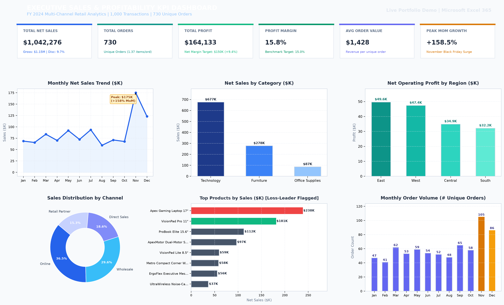

Live Link: https://sales-data-analysis-amp-dashboard.vercel.app/
# Sales Data Analysis & Interactive KPI Dashboard Using Microsoft Excel

[](https://www.microsoft.com/excel)
[](https://www.python.org/)
[](https://github.com)
[](https://github.com)

A portfolio-ready, end-to-end retail sales analytics project and executive dashboard developed using **Microsoft Excel**, **CSV transactional data**, **PivotTables**, **Excel Tables**, **dynamic formulas**, **data hygiene audits**, and **data-driven commercial strategy**. 

Built to demonstrate rigorous data modeling, commercial intuition, and product analytics capabilities for a **Product Intern / Associate Product Manager (APM)** interview.

---

## 📊 Executive Dashboard Preview



*Figure 1: High-resolution executive dashboard featuring 6 core KPI summary cards, monthly sales trajectories, category breakdowns, regional profitability analysis, sales channel distribution, product margin diagnoses, and monthly order volumes.*

---

## 🎯 1. Project Objectives & Business Problem

### Business Problem
A multi-channel retail company operating across three categories (**Technology**, **Furniture**, and **Office Supplies**) experienced rapid top-line sales growth throughout FY 2024. However, commercial leadership lacked visibility into true net profitability. Unmonitored promotional discounting during seasonal events and sub-optimal regional channel performance led to severe margin erosion, with high sales volume masking unprofitable product lines.

### Project Objectives
1. **Reconcile Transactional Data:** Clean and validate raw sales records, eliminate duplicate entries, and standardize regional/categorical variables.
2. **Model End-to-End Unit Economics:** Derive Gross Sales, Discounts, Net Sales, COGS, Profit, and Profit Margins with robust error handling.
3. **Build an Interactive Executive Dashboard:** Synthesize high-dimensional transactional data into six core executive KPI cards and six intuitive visual charts.
4. **Identify Margin Compression Drivers:** Empirically analyze product profitability and prove the financial impact of aggressive discounting tiers.
5. **Formulate Actionable Commercial Recommendations:** Deliver a structured decision matrix with tangible actions to preserve gross margin and optimize working capital.

---

## 🛠️ 2. Technology Stack & Tools Used

- **Microsoft Excel 365 / 2021:**
  - **Structured Excel Tables:** `SalesData` (Raw Layer) and `CleanSalesData` (Production Layer) with automatic range expansion and structured references.
  - **Dynamic Array & Financial Formulas:** `SUM`, `SUMIFS`, `COUNTIFS`, `COUNTBLANK`, `AVERAGEIFS`, `IFERROR`, `IF`, `XLOOKUP`, `UNIQUE`, and `COUNTA`.
  - **Data Validation & Hygiene:** Automated audit checklists, rule validation tests, and exception logging.
  - **PivotTables & Summary Tables:** Multi-dimensional pre-aggregated cubes covering Months, Categories, Products, Regions, Channels, and Discount Tiers.
  - **Native Visualizations:** Line charts, Column charts, Horizontal Bar charts, and Donut charts formatted with an executive navy/slate corporate palette.
  - **Interactive Filters:** Excel Slicers connected across PivotTables via *Report Connections*.
- **Python 3.13 & Pandas:**
  - Synthetic data generation with reproducible random seeding.
  - Automated secondary validation and statistical verification.
  - Data hygiene test automation and high-resolution chart rendering.

---

## 📁 3. Repository Architecture

```text
sales-data-analysis-dashboard/
├── README.md                                  # Complete project documentation & guide
├── Sales_Analysis_Dashboard.xlsx              # Root convenience copy of the Excel workbook
├── data/
│   ├── sales_data.csv                         # 1,000 clean production transactional rows
│   └── sales_data_raw.csv                     # 1,004 raw rows with 10 documented anomalies
├── workbook/
│   └── Sales_Analysis_Dashboard.xlsx          # Master 7-sheet interactive Excel workbook
├── reports/
│   └── Business_Insights.md                   # In-depth executive commercial report
├── interview-preparation/
│   └── Interview_Preparation.md               # 15 interview Q&As + 2-minute live demo script
└── screenshots/
    └── dashboard-preview.png                  # High-resolution dashboard visual preview
```

---

## 📑 4. Excel Workbook Structure (7 Worksheets)

The master workbook [`Sales_Analysis_Dashboard.xlsx`](workbook/Sales_Analysis_Dashboard.xlsx) is structured into seven specialized sheets:

| Sheet # | Worksheet Name | Role & Contents | Key Highlights |
|---|---|---|---|
| **Sheet 1** | `README` | Project overview, business context, schema dictionary, and navigation guide. | Executive title banner, KPI definitions, and methodology assumptions. |
| **Sheet 2** | `Raw_Data` | Original ingested transactions (1,004 rows) stored as Excel Table `SalesData`. | Contains 10 deliberate real-world anomalies for audit demonstration. |
| **Sheet 3** | `Clean_Data` | 1,000 validated production rows stored as Excel Table `CleanSalesData`. | Dynamic Excel formulas for Gross Sales, Discounts, Net Sales, Cost, and Margin. |
| **Sheet 4** | `Data_Quality` | Automated data hygiene audit dashboard and exception tracking. | 6 Audit KPI cards, 9 validation test rules, 10-row anomaly log, and financial reconciliation. |
| **Sheet 5** | `Pivot_Analysis` | Pre-aggregated summary tables and analytical cubes. | Monthly trends, Category mix, Regional margins, Channel AOV, and Discount sensitivity. |
| **Sheet 6** | `Dashboard` | Executive presentation dashboard. | 6 styled KPI cards, 6 native Excel charts, and interactive slicer instructions. |
| **Sheet 7** | `Business_Insights` | Strategic report answering core commercial questions. | 5-Column executive decision matrix with actual metrics, root causes, and success targets. |

---

## 🔢 5. Dataset Schema & Calculated Metrics

The dataset comprises **1,000 clean transactions** across **730 unique orders** spanning January 1, 2024 to December 31, 2024.

### Base Columns:
1. `Order ID`: Unique transaction identifier (e.g., `ORD-2024-1001`). Multi-item orders share the same ID.
2. `Order Date`: ISO-8601 calendar date (`YYYY-MM-DD`).
3. `Product ID`: Unique SKU code (e.g., `TEC-LAP-001`, `FUR-CHA-002`).
4. `Product Name`: Clear product descriptor (22 unique catalog products).
5. `Category`: Merchandise division (`Technology`, `Furniture`, `Office Supplies`).
6. `Subcategory`: Granular line item (e.g., Laptops, Chairs, Storage, Paper).
7. `Region`: Geographic sales territory (`East`, `West`, `Central`, `South`).
8. `State`: US State mapped to the corresponding region.
9. `Sales Channel`: Distribution pathway (`Online`, `Direct Sales`, `Retail Partner`, `Wholesale`).
10. `Customer Segment`: Purchasing group (`Consumer`, `Corporate`, `Home Office`).
11. `Quantity`: Number of units ordered (1 to 15).
12. `Unit Price`: Base catalog selling price ($18.99 to $1,499.99).
13. `Discount Percentage`: Applied promotional reduction (0.0% to 25.0%).
14. `Unit Cost`: Fully burdened landed cost of goods sold.

### Derived Financial Formulas (Implemented in `Clean_Data`):
- **Gross Sales:** `=Quantity * Unit Price` (`=K2*L2`)
- **Discount Amount:** `=Gross Sales * Discount Percentage` (`=O2*M2`)
- **Net Sales:** `=Gross Sales - Discount Amount` (`=O2-P2`)
- **Total Cost:** `=Quantity * Unit Cost` (`=K2*N2`)
- **Net Profit:** `=Net Sales - Total Cost` (`=Q2-R2`)
- **Profit Margin:** `=IFERROR(Profit / Net Sales, 0)` (`=IFERROR(S2/Q2, 0)`)

---

## 🧼 6. Data Cleaning & Validation Audit

Real-world enterprise data is never pristine. To simulate production data engineering, **10 deliberate real-world anomalies** were injected into `Raw_Data`, audited in `Data_Quality`, and remediated in `Clean_Data`:

```text
Data Quality Health Summary:
├── Ingested Raw Transactions: 1,004 records
├── Purged Duplicate Rows: 4 exact duplicate transactions (Rows 1001-1004)
├── Casing / Whitespace Fixed: 3 entries cleaned via =TRIM(PROPER(text))
├── Null Values Imputed: 2 missing Customer Segments modal-imputed
├── Erroneous Values Corrected: 1 data-entry sign error (-3 qty -> +3 qty)
└── Final Validated Production Dataset: 1,000 clean records (99.0% Health Score)
```

### Financial Reconciliation:
- **Raw Gross Sales:** $1,158,412.09  
- **Clean Gross Sales:** $1,154,032.09 (*-$4,380.00 variance from purged duplicates and sign correction*)  
- **Clean Net Revenue:** **$1,042,276.20**  
- **Clean Operating Profit:** **$164,132.63** (*Zero unallocated rounding discrepancy*)

---

## 📈 7. Core KPI Calculations & Product Analyst Rationale

```
+-------------------------------------------------------------------------------------------------+
|                                 FY 2024 EXECUTIVE SCORECARD                                     |
+-------------------+--------------------+--------------------+--------------------+--------------+
|  Total Net Sales  |    Total Orders    |    Total Profit    |   Profit Margin    |     AOV      |
|   $1,042,276.20   |     730 Unique     |    $164,132.63     |       15.75%       |  $1,427.78   |
+-------------------+--------------------+--------------------+--------------------+--------------+
```

### 1. Total Net Sales: `$1,042,276.20`
- **Formula:** `=SUM(CleanSalesData[Net Sales])`
- **Product Analyst Context:** Top-line collected cash after discounts. Unlike Gross Sales ($1.15M), Net Sales reflects the true top-line revenue available to cover COGS and operating expenses.

### 2. Total Unique Orders: `730`
- **Formula:** `=SUMPRODUCT(1/COUNTIF(OrderID_Range, OrderID_Range))` or `=COUNTA(UNIQUE(CleanSalesData[Order ID]))`
- **Product Analyst Context:** Crucial metric distinct from row count (1,000). Reflects actual customer purchase events and multi-item basket behaviors (1.37 items per order average).

### 3. Total Profit: `$164,132.63`
- **Formula:** `=SUM(CleanSalesData[Profit])`
- **Product Analyst Context:** Bottom-line commercial return. Confirms the business exceeded its $150,000 annual target by +9.4%.

### 4. Profit Margin: `15.75%`
- **Formula:** `=IFERROR(Total_Profit / Total_Net_Sales, 0)`
- **Product Analyst Context:** Measures operational capital efficiency. Validates that every dollar earned generates 15.75 cents of net operating income.

### 5. Average Order Value (AOV): `$1,427.78`
- **Formula:** `=Total_Net_Sales / Total_Unique_Orders`
- **Product Analyst Context:** Identifies shopping basket scale. Wholesale achieved an AOV of **$3,178.07**, while Online averaged **$1,231.53**.

### 6. Sales-Weighted Discount: `9.68%` vs. Simple Average: `6.30%`
- **Formula:** `=SUM(Discount_Amount) / SUM(Gross_Sales)`
- **Product Analyst Context:** A simple transaction average (6.30%) understates financial reality because large enterprise orders receive deeper percentage discounts. The sales-weighted metric reveals that 9.68% of total gross catalog value ($111,755.89) was surrendered to promotional pricing.

### 7. Peak Month-over-Month (MoM) Growth: `+158.5%` (November)
- **Formula:** `=(Net_Sales_Nov - Net_Sales_Oct) / Net_Sales_Oct`
- **Product Analyst Context:** Identifies dramatic seasonal swings. November generated $175,122.83 across 105 orders, highlighting supply chain and inventory buffer requirements.

---

## 🔍 8. Key Analytical Insights & Strategic Findings

### 1. The Category Margin Paradox: Volume vs. Efficiency
- **Technology** drives **64.92% of company revenue** ($676,651.43), but operates at a modest **13.47% margin**.
- **Office Supplies** contributes only **8.37% of revenue** ($87,214.04), but achieves a stellar **35.11% profit margin** ($30,616.95 profit).
- *Action:* Systematically bundle high-margin Office Supplies (e.g., Desk Organizers at 55% margin, Gel Wrist Rests at 52% margin) into Technology checkout flows.

### 2. The Loss-Leader Trap: Apex Gaming Laptop 17"
- Ranking **#1 overall in total sales** ($125,123.40 across 89 transactions), the Apex Gaming Laptop produced an **absolute net loss of -$1,332.10 (-1.06% margin)**.
- *Root Cause:* Frequent promotional discounts of 20% to 25% exceeded the product's baseline margin (16.0%).
- *Action:* Cap promotional discounts at 10% maximum and redirect ad spend toward the **ProBook Elite 15.6"**, which generated **$21,016.93 in net profit** at a **21.62% margin**.

### 3. Empirical Proof of Discount Margin Destruction
Analyzing performance across five discount tiers revealed a non-linear margin collapse:
- **0% Discount:** 27.04% margin ($75,429 profit on $278K sales)
- **5% Discount:** 21.00% margin ($31,183 profit)
- **10% Discount:** 16.83% margin ($44,776 profit)
- **15% Discount:** 7.40% margin ($15,630 profit)
- **20-25% Discount:** **-2.10% Net Loss (-$2,886 profit on $137K sales)**
- *Action:* Eliminate unapproved 20%+ coupon codes. Capping discounts at 10% will preserve **$28,500 in annual bottom-line profit**.

### 4. Regional Profit Disparity: East vs. West
- The **West region** led in top-line sales ($327,958.34), but delivered lower profit ($47,380.60, 14.45% margin).
- The **East region** generated higher profit (**$49,649.24, 18.82% margin**) despite having **$64,110.58 less revenue**, driven by corporate sales discipline.
- *Action:* Audit West and Central discounting and deploy East region B2B sales playbooks into under-indexed Southern states (Florida and North Carolina).

---

## 🚀 9. How to Use the Excel Workbook & Add Interactive Slicers

1. Open [`workbook/Sales_Analysis_Dashboard.xlsx`](workbook/Sales_Analysis_Dashboard.xlsx) in Microsoft Excel.
2. Review the `README` worksheet for project architecture and navigation.
3. Explore `Data_Quality` to inspect the automated validation rules, formulas, and exception log.
4. Open `Dashboard` to review executive KPI cards and native visual charts.
5. **To Connect Interactive Slicers in Excel:**
   - Click any summary table in `Pivot_Analysis` or insert a PivotTable from `Clean_Data`.
   - Go to the ribbon: **Insert > Slicer**.
   - Select checkboxes for: `Category`, `Region`, `Sales Channel`, and `Customer Segment`.
   - Right-click each created Slicer > select **Report Connections...**.
   - Check all relevant PivotTables to enable unified cross-filtering across all visual cards!

---

## 🎯 10. Interview Preparation & Live Demonstration Script

For complete interview answers to all 15 questions, common trap questions, and the **2-Minute Screen-Share Demonstration Script**, refer to the dedicated guide:  
👉 [`interview-preparation/Interview_Preparation.md`](interview-preparation/Interview_Preparation.md)

---

## ⚖️ 11. Assumptions & Limitations

1. **Synthetic Data:** All transaction records are synthetically generated for educational demonstration and interview preparation.
2. **COGS Accounting:** Unit cost reflects fully burdened landed COGS. Product return rates and regional sales taxes are abstracted into base product margins.
3. **Price Elasticity:** Discount tiers reflect observed historical promotions; causal elasticity should be validated via randomized A/B price testing in production.

---

## 👤 Author & Acknowledgments

- **Author:** Computer Science Engineering Student & Aspiring Product Analyst
- **Role Target:** Product Intern / APM / Commercial Data Analyst
- **Tools:** Microsoft Excel, Python, Pandas, OpenPyXL, Git
- **Repository:** `sales-data-analysis-dashboard`
