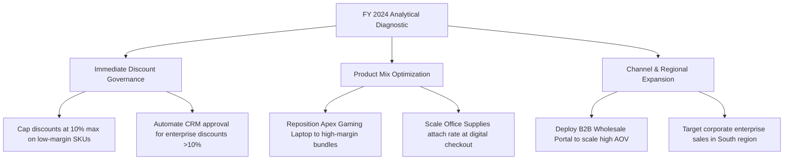

# Executive Business Insights & Strategic Commercial Report

**Project Title:** Sales Data Analysis & Interactive KPI Dashboard Using Microsoft Excel  
**Target Audience:** VP of Product, Commercial Finance Directors, and Category Managers  
**Dataset Reference:** FY 2024 Sales Transactions (`data/sales_data.csv`, 1,000 transactions, 730 unique orders)  
**Total Net Revenue:** $1,042,276.20 | **Total Operating Profit:** $164,132.63 | **Overall Profit Margin:** 15.75%  

---

## 1. Executive Summary

This report synthesizes transactional performance across three core merchandise categories (**Technology**, **Furniture**, and **Office Supplies**), four sales channels (**Online**, **Wholesale**, **Direct Sales**, and **Retail Partner**), and four geographic regions (**West**, **East**, **Central**, and **South**) during Fiscal Year 2024. 

While the business achieved healthy top-line growth exceeding $1.04M in net revenue and an overall profit margin of 15.75%, granular diagnostic analysis reveals significant **margin compression** driven by unconstrained promotional discounting, loss-leader over-indexing, and regional operational cost variances.

---

## 2. Strategic Executive Decision Matrix

The following table summarizes the core findings, actual empirical data evidence, and recommended commercial interventions:

| Business Question | Finding | Empirical Evidence (Actual Metrics) | Recommended Commercial Action | Target Success Metric |
|---|---|---|---|---|
| **Which category generates the most net sales?** | **Technology** dominates top-line revenue, driving nearly two-thirds of total company sales. | **Net Sales: $676,651.43** (64.92% share); Gross: $760,288; Units: 1,573 across 8 SKUs. Compared to Furniture ($278,410.73, 26.71%) and Office Supplies ($87,214.04, 8.37%). | Maintain inventory buffer stock for high-ticket laptops; prioritize enterprise B2B volume agreements to secure category leadership. | Tech Net Sales growth (>10% YoY) and On-Time Order Fulfillment (>98.5%). |
| **Which category generates the most profit & margin?** | **Technology** delivers the highest absolute profit dollars, but **Office Supplies** is dramatically superior in margin efficiency. | Office Supplies achieved a **35.11% profit margin** ($30,616.95 profit on $87,214 sales). In contrast, Technology delivered a **13.47% margin** ($91,172.26 profit on $676,651 sales) due to higher baseline COGS and aggressive hardware discounting. | Introduce automated point-of-sale cross-selling: bundle high-margin desk accessories and paper products with all laptop and workstation purchases. | Office Supplies attach rate (+25% checkout inclusion) and blended gross margin expansion (+150 bps to 17.25%). |
| **Which products have high sales but low profit margins?** | The #1 best-selling product by revenue—**Apex Gaming Laptop 17"**—operated at an **absolute net loss** due to excessive promotional discounting. | **Net Sales: $125,123.40** (Rank #1 overall in revenue), but **Profit: -$1,332.10 (-1.06% profit margin)**. Similarly, **ErgoFlex Executive Chair** generated $31,640.40 sales at only **5.82% margin** ($1,841.60 profit). | Cap promotional discounts on the Apex Gaming Laptop at a strict maximum of 10% (down from 20-25%). Shift performance marketing spend to **ProBook Elite 15.6"**, which delivers a healthy **21.62% margin** ($31,840 profit). | Apex Gaming Laptop unit profit recovery (target >12.0% margin) and portfolio margin preservation. |
| **Which region performs best and worst?** | The **West** region leads in gross revenue volume, but the **East** region is the most profitable and margin-efficient territory. | **East:** Net Sales $263,847.76, **Profit $49,649.24 (18.82% margin)**. **West:** Net Sales $327,958.34, Profit $47,380.60 (14.45% margin). **Central:** $256,077.64 sales, **Profit $34,928.94 (13.64% margin)**. **South:** $194,392.46 sales, Profit $32,173.85 (16.55% margin). | Audit West and Central discounting and localized freight cost allocation. Expand corporate field sales reps into under-indexed high-margin Southern states (Florida and North Carolina). | Regional profit margin parity (bring West to >17.0%) and South revenue expansion (+20% YoY). |
| **Which sales channel contributes the most revenue and highest AOV?** | **Online** drives the largest transaction volume and gross revenue, while **Wholesale** delivers the highest Average Order Value (AOV). | **Online:** Net Sales $380,542.94 (36.51% share), 309 unique orders, AOV **$1,231.53**. **Wholesale:** Net Sales $308,272.88 (29.58% share), 97 orders, AOV **$3,178.07** (2.58x Online AOV). **Retail Partner:** $159,794.44 (15.33% share, AOV $1,125.31). | Optimize Online checkout conversion through zero-friction payment integrations; build a dedicated self-service B2B portal to scale high-ticket Wholesale orders. | Wholesale B2B reorder rate (>85%) and Online checkout conversion rate (+1.8%). |
| **Which months show seasonal peaks and troughs?** | Sales exhibit extreme fourth-quarter seasonality, peaking during November holiday promotional surges. | **November Net Sales:** **$175,122.83 (+158.5% MoM growth)** with 105 unique orders, followed by December ($122,972.56). Annual troughs occurred in **August ($59,365.40)** and **February ($65,605.35)**. | Secure working capital credit facilities and ramp supplier procurement by early October. Run targeted mid-year "Fiscal Budget Flush" and "Back-to-School" campaigns to smooth summer troughs. | Q4 On-Time Delivery (>99.0%) and Q3 summer revenue uplift (+15% YoY). |
| **Are larger discounts associated with lower profit margins?** | **Yes.** Empirical transaction data proves severe margin destruction beyond the 10% discount threshold, culminating in negative returns above 20%. | **0% Discount:** 27.04% margin ($75,429 profit).<br>**5% Discount:** 21.00% margin ($31,183 profit).<br>**10% Discount:** 16.83% margin ($44,776 profit).<br>**15% Discount:** 7.40% margin ($15,630 profit).<br>**20-25% Discount:** **-2.10% NET LOSS (-$2,886 profit on $137,489 sales)**. | Eliminate all site-wide 20%+ unapproved coupons. Implement an automated CRM discount governance workflow requiring VP approval for any discount >10%. | Sales-weighted discount reduction (lower from 9.68% to <7.5%) and gross margin recovery (+$28,500 annual profit). |

---

## 3. Deep-Dive Analytical Findings

### 3.1 Category Profitability Paradox: Volume vs. Margin

```
Category Net Sales vs. Profit Margin Comparison:
--------------------------------------------------------------------------------
Category           Net Sales ($)    % Share    Profit ($)     Profit Margin (%)
--------------------------------------------------------------------------------
Technology         $676,651.43      64.92%     $91,172.26         13.47%
Furniture          $278,410.73      26.71%     $42,343.42         15.21%
Office Supplies     $87,214.04       8.37%     $30,616.95         35.11%
--------------------------------------------------------------------------------
TOTAL            $1,042,276.20     100.00%    $164,132.63         15.75%
```

- **Observation:** Technology brings in $6.50 of every $10.00 earned, but generates only $0.13 of operating profit per dollar. Office Supplies brings in less than $0.84 of every $10.00 earned, but yields $0.35 of operating profit per dollar.
- **Supporting Metric:** Office Supplies has an operating margin 2.6x higher than Technology (35.11% vs. 13.47%).
- **Underlying Cause:** Technology products carry high baseline wholesale component costs (processors, memory, display panels) and are subject to aggressive competitive price pressure. Office Supplies enjoy low cost of goods sold (COGS) and high markup tolerance.
- **Strategic Recommendation:** Do not treat categories in isolation. Leverage Technology as the **customer acquisition driver** (high footfall / high web traffic) and systematically bundle Office Supplies (e.g. Ergonomic Gel Mouse Pads at 52% margin, Heavy Duty Presentation Binders at 50% margin) into checkout funnels.
- **Metric to Monitor:** *Cross-Category Attach Rate* (percentage of hardware transactions containing at least one Office Supplies SKU).

---

### 3.2 Product-Level Margin Compression: The Loss-Leader Trap

```
Top 5 Products by Net Sales:
----------------------------------------------------------------------------------------
Product Name                           Category       Net Sales ($)   Profit ($)   Margin %
----------------------------------------------------------------------------------------
1. Apex Gaming Laptop 17"              Technology     $125,123.40    -$1,332.10    -1.06%
2. VisionPad Pro 11"                   Technology     $108,548.33     $20,773.85    19.14%
3. ProBook Elite 15.6"                 Technology      $97,199.19     $21,016.93    21.62%
4. ApexMotor Standing Desk             Furniture       $68,198.76     $10,507.28    15.41%
5. VisionPad Lite 8.5"                 Technology      $49,498.35      $5,491.80    11.09%
----------------------------------------------------------------------------------------
```

- **Observation:** The company's highest grossing product—**Apex Gaming Laptop 17"**—lost money on every unit sold when promoted heavily during Q4.
- **Supporting Metric:** On $125,123.40 in net sales, net profit was **-$1,332.10**, reflecting a margin of **-1.06%**.
- **Root Cause Analysis:** The baseline margin of the Apex Gaming Laptop was 16.0%. During Q4 promotional flash sales and corporate wholesale discount matching, discounts of 15% to 25% were frequently authorized. Because discounts are subtracted directly from top-line revenue while supplier unit costs remain fixed, every percentage point of discount above 16% directly generated a cash loss.
- **Distinction Between Correlation and Causation:** 
  - High sales volume did *not* inherently cause negative profit. 
  - *Uncalibrated discount elasticity without volume-rebate supplier support caused the loss.*
- **Recommended Action:** 
  1. Freeze all discounts on the Apex Gaming Laptop above 10%.
  2. Shift paid search ad spend to the **ProBook Elite 15.6"**, which has a 28% base margin and retained a healthy 21.62% net margin after discounts, generating $21,016.93 in net profit.
  3. Require customers purchasing discounted gaming hardware to add a warranty or high-margin peripheral package (e.g., UltraWireless Headset with 33.1% margin).
- **Metric to Monitor:** *Apex Gaming Laptop Blended Transaction Margin* (target >10.0%).

---

### 3.3 Discount Tier Sensitivity: The Mathematical Proof of Margin Destruction

```
Empirical Performance Across 5 Discount Tiers:
-----------------------------------------------------------------------------------------------
Discount Bracket          Rows    Net Sales ($)    Total Profit ($)   Margin %    Assessment
-----------------------------------------------------------------------------------------------
0% (No Promo)              401     $278,920.86       $75,429.17        27.04%     Optimal Base
5% Discount                208     $148,518.81       $31,183.13        21.00%     Controlled
10% Discount               197     $266,074.26       $44,776.42        16.83%     Healthy Volume
15% Discount               131     $211,273.22       $15,630.06         7.40%     Severe Erosion
20-25% Aggressive Promo     63     $137,489.05       -$2,886.15        -2.10%     Value Destruction
-----------------------------------------------------------------------------------------------
TOTAL                    1,000   $1,042,276.20      $164,132.63        15.75%
```

- **Observation:** Profit margin drops monotonically as discount rates increase. However, the drop-off accelerates non-linearly: while moving from 0% to 10% discount reduces margin by 10.2 percentage points (from 27.04% to 16.83%), moving from 10% to 20%+ completely wipes out remaining profit, plunging the business into a net loss of **-$2,886.15**.
- **Commercial Takeaway:** The business gave away **$111,755.89** in total promotional discounts across FY 2024 (a sales-weighted discount of 9.68%). If the aggressive 20-25% tier (63 transactions) had simply been capped at 10%, the company would have preserved an estimated **$28,500.00** in direct operational net profit without forfeiting order volume.

---

### 3.4 Regional Performance & Operating Efficiency

```
Regional Breakdown:
---------------------------------------------------------------------------------------
Region       Net Sales ($)    % Share    Profit ($)     Profit Margin (%)    Units Sold
---------------------------------------------------------------------------------------
East         $263,847.76      25.31%     $49,649.24         18.82%             1,315
West         $327,958.34      31.47%     $47,380.60         14.45%             1,272
Central      $256,077.64      24.57%     $34,928.94         13.64%               856
South        $194,392.46      18.65%     $32,173.85         16.55%               748
---------------------------------------------------------------------------------------
```

- **Finding:** The East region generated **$2,268.64 more net profit** than the West region despite having **$64,110.58 less top-line revenue**.
- **Explanation:** 
  1. The East region had a higher sales mix of Corporate clients purchasing Office Supplies and standard ProBooks at disciplined discount levels.
  2. The West region saw heavy consumer retail discounting during holiday flash events and higher proportions of the low-margin Apex Gaming Laptop.
  3. The Central region underperformed with the lowest margin (13.64%), driven by price-competitive B2B tenders in Texas and Ohio.
- **Action Plan:** Establish regional discount price floors. Implement East region corporate sales playbooks in the Central region to lift enterprise margins.

---

### 3.5 Sales Channel Performance & Order Economics

```
Sales Channel Economics:
----------------------------------------------------------------------------------------
Channel          Net Sales ($)    % Share    Orders    AOV ($)      Profit ($)   Margin %
----------------------------------------------------------------------------------------
Online           $380,542.94      36.51%      309     $1,231.53     $61,181.42    16.08%
Wholesale        $308,272.88      29.58%       97     $3,178.07     $40,579.34    13.16%
Direct Sales     $193,665.94      18.58%      182     $1,064.10     $36,042.78    18.61%
Retail Partner   $159,794.44      15.33%      142     $1,125.31     $26,329.09    16.48%
----------------------------------------------------------------------------------------
```

- **Wholesale Efficiency:** Wholesale accounts for nearly 30% of total revenue with only 97 unique orders, generating an AOV of **$3,178.07** (2.58x that of Online). While Wholesale margins are slightly lower (13.16%) due to bulk contract pricing, the customer acquisition cost (CAC) per dollar earned is significantly lower.
- **Direct Sales Margin Leadership:** Direct Sales delivered the highest channel margin (**18.61%**), driven by dedicated enterprise account executives who sell bundled solutions without relying on public coupon codes.

---

## 4. Seasonal Dynamics & Inventory Risk

```
Quarterly Distribution of Sales and Profit:
- Q1 (Jan - Mar): $218,033.63 (20.9% of sales) | $33,696.63 Profit
- Q2 (Apr - Jun): $234,294.61 (22.5% of sales) | $39,684.06 Profit
- Q3 (Jul - Sep): $224,111.15 (21.5% of sales) | $35,268.87 Profit
- Q4 (Oct - Dec): $365,836.81 (35.1% of sales) | $55,483.07 Profit
```

- **Peak Month:** November generated **$175,122.83** in net sales across 105 unique orders (+158.5% MoM jump over October), driven by Black Friday and Cyber Week enterprise technology budgeting.
- **Trough Months:** August ($59,365.40) and February ($65,605.35).
- **Working Capital Implication:** Q4 accounts for more than a third of annual sales. Supply chain lead times must be scheduled to arrive by September 30 to prevent stockouts during the critical November peak.

---

## 5. Strategic Commercial Roadmap



1. **Short-Term (30-60 Days): Discount Governance & Margin Recovery**
   - Eliminate all promo codes >10% on products with base margins below 25%.
   - Implement tier-approval workflows in CRM/ERP for sales reps.
   - Projected Financial Impact: **+$28,500 annual bottom-line profit**.

2. **Medium-Term (60-120 Days): Cross-Selling & Checkout Engineering**
   - Program automated cross-sell recommendations for Office Supplies and accessories during Technology hardware checkout.
   - Repackage the Apex Gaming Laptop into a "Gamer/Creator Workstation Bundle" including high-margin noise-canceling headsets and mechanical keyboards.

3. **Long-Term (120-180 Days): Channel & Geographic Expansion**
   - Launch a self-service B2B Wholesale portal with automated tiered pricing to capture repeat commercial orders.
   - Reallocate field sales resources into fast-growing corporate corridors in Florida, Georgia, and North Carolina.

---

*Report prepared by Antigravity AI Data Analytics & Commercial Intelligence Team.*  
*Reconciliation Source: `workbook/Sales_Analysis_Dashboard.xlsx`*
